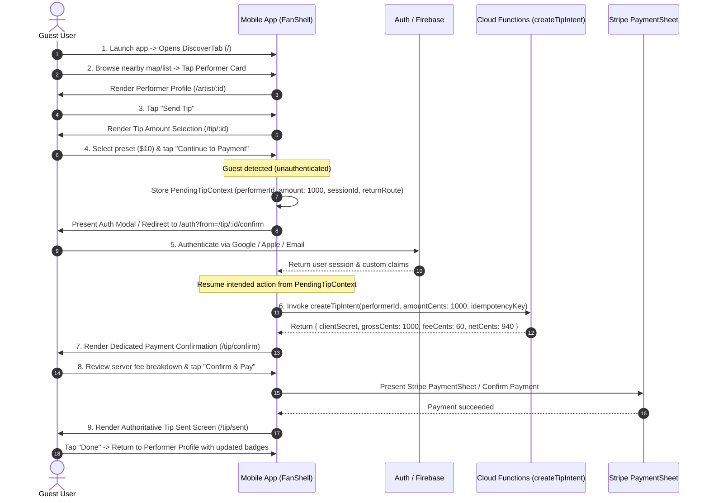
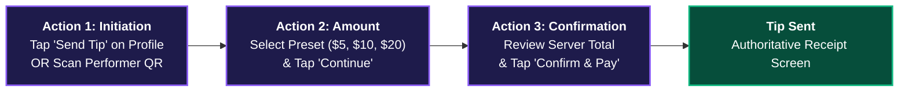
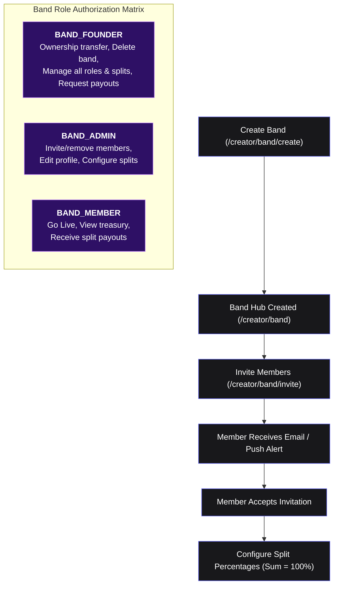

# Crowdbeats Mobile Redesign: Core Journey & Flow Specifications (Phase 2)

**Document Status:** Complete & Approved Specification  
**Owners:** UX Coordinator, Payments Lead, Creator/Band Lead  
**Scope:** Tipping Journeys, Creator Lifecycle, Band Governance, and Error Recovery Protocols  

---

## 1. Tipping Journeys

### 1.1 Flow A: Guest Discovery to Tip Sent (With Intent Resumption)



#### Detailed Step Specification (Guest)
1. **Entry:** Guest opens the app without credentials. Discover tab loads active nearby sessions using low-power coarse geolocation.
2. **Act Selection:** Guest taps on a live performer card (e.g. "Elena Cruz @ Saxon Pub"). Public profile loads with bio, setlist, and live badge.
3. **Amount Selection:** Guest taps primary CTA "Send Tip". Screen `/tip/:id` displays preset chips (`$2`, `$5`, `$10`, `$20`), custom numeric keypad, and optional cheer message.
4. **Auth Trigger:** Tapping "Continue to Payment" detects `currentUser == null`. The app serializes state into `PendingTipContext` and opens the authentication sheet.
5. **Auth Cancellation Recovery:** If the user dismisses the auth sheet, they are returned directly to the amount selection screen with their selected amount and message intact.
6. **Intent Resumption:** Upon sign-in or account creation, GoRouter intercepts the auth state change, detects the pending tip, and proceeds directly to `/tip/confirm`.
7. **Server Calculation:** Client invokes `createTipIntent` callable. Displays the authoritative numbers: Gross Tip: `$10.00`, Crowdbeats 6% Platform Fee: `$0.60`, Net to Artist: `$9.40`. No client-side fee formula is calculated.
8. **Authoritative Confirmation:** Payment confirmed via Stripe SDK. Webhook listener confirms document creation in `paymentTransactions`.
9. **Exit:** `TipSentScreen` displays animated confirmation, receipt reference ID, and social action buttons ("Follow Elena Cruz", "Share Tip"). Tapping "Done" returns to the performer profile.

---

### 1.2 Flow B: Returning Fan Quick-Tipping (3-Action Streamlined Flow)

For an authenticated, returning Fan with a saved payment method (e.g., Apple Pay, Google Pay, or saved card on file):



#### The 3 Meaningful User Actions:
1. **Action 1 (Initiate):** Tap `"Send Tip"` on the performer profile OR point camera at the venue QR code.
2. **Action 2 (Amount):** Tap preset chip (e.g. `$10`) and tap `"Continue"`.
3. **Action 3 (Confirm):** Review server-verified totals and tap `"Confirm & Pay"`.
*(Note: Device biometric prompt such as FaceID/Fingerprint is OS payment security and not considered a redundant app navigation step).*

---

## 2. Creator & Band Lifecycle

### 2.1 Four Discrete Creator Lifecycle States

To ensure absolute financial and legal integrity, every creator profile transitions through four explicit lifecycle states:

```
[State 1: Account Created] 
       │ (Stage name, handle, genre, bio, avatar submitted)
       ▼
[State 2: Profile Completed] 
       │ (Stripe Connect Express onboarding completed)
       ▼
[State 3: Identity Verified] 
       │ (Bank account verified, tax info approved, payouts enabled)
       ▼
[State 4: Payout Eligible]
```

1. **State 1: Account Created (`roles: ['artist']`):**
   - User has signed up and selected the Musician/Artist persona.
   - CreatorStudio is accessible in "Setup Mode".
   - *Restrictions:* Cannot Go Live; cannot receive real tips; cannot request payouts.
2. **State 2: Profile Completed (`isPublished: true`):**
   - Minimum required profile submitted: Stage Name (2-50 chars), Unique Handle (`@handle`), Primary Genre, Short Bio, and Profile Photo.
   - Performer is now discoverable in public discovery and map searches.
   - *Restrictions:* Go Live is disabled with banner: "Connect bank account with Stripe to start receiving live tips".
3. **State 3: Identity Verified (`stripeConnected: true`):**
   - Creator has completed Stripe Connect Express hosted onboarding.
   - Identity documents and SSN/EIN validated by Stripe.
   - `chargesEnabled == true` on Stripe account.
   - *Capabilities:* Full Go Live enabled; QR generation enabled; can receive live audience tips.
4. **State 4: Payout Eligible (`payoutsEnabled: true`):**
   - Payout destination (checking account or debit card) verified by Stripe.
   - Available balance exceeds platform minimum ($10.00).
   - *Capabilities:* Can submit payout requests via `requestPayout` callable. Standard rolling transfers (2-3 business days) initiated.

---

### 2.2 Solo Musician Onboarding Journey
1. **Persona Selection:** During universal onboarding wizard (`/onboarding`), user selects `"Solo Musician"`.
2. **Minimum Required Profile:**
   - Stage Name (Required)
   - Unique Handle (Validated in real time via `checkHandleAvailability` callable)
   - Primary Genre (Single selection from curated music taxonomy)
   - Bio (Max 280 characters)
   - Avatar image (Uploaded via Firebase Storage)
3. **Deferred Optional Details:** Social links, Spotify embed, secondary instruments, and gallery photos are deferred to "Edit Profile" in Studio settings to prevent registration drop-off.
4. **Studio Landing:** Creator lands on `CreatorStudioTab`. Prominent checklist card guides completion:
   - [x] Create artist profile
   - [ ] Connect Stripe for payouts (CTA: "Complete Stripe Verification")
   - [ ] Test QR code

---

### 2.3 Band Lifecycle, Membership Authorization & Split Rules



#### Band Split Governance Rules
* **Sum to 100% Rule:** Total member split percentages plus optional Band Treasury retention must equal exactly `100.0%`.
* **Live Performance Lock:** While a live session is broadcasting (`liveSessionState.isActive == true`), split percentages are strictly **locked** to prevent mid-set financial disputes.
* **Pending Transfer Lock:** Split modifications are blocked while a batch treasury transfer is executing.

---

## 3. Error Recovery & Edge Case Protocols

| Edge Case Scenario | Trigger Condition | System Behavior & UX Recovery Path |
|---|---|---|
| **Authentication Cancellation** | Guest prompts auth during tip flow, then taps "Cancel" or "Close". | App preserves `PendingTipContext`. Closes auth modal without resetting amount selection. User returns to exact tip amount screen with notice: "Tip saved as draft". |
| **Interrupted Onboarding** | User force-closes app during onboarding steps 1, 2, or 3. | On next launch, `cbAuthRedirect` inspects `onboardingCompleted` claim. Automatically routes user to their exact unfinished step (`/onboarding/step-X`) with previously entered draft fields restored from local state. |
| **Unsaved Edits** | Creator modifies profile or band splits and taps hardware/app back button without saving. | Intercepted via `WillPopScope` / `PopScope(canPop: false)`. Displays standard system dialog: *"Discard unsaved changes? Any edits will be lost."* [Keep Editing] [Discard]. |
| **Location Permission Denied** | User denies GPS access on Discover tab or Go Live tab. | **Discover Tab:** Renders clean inline banner: *"Location access disabled. Search by venue or city to find live acts."* Displays manual city search input. <br/>**Go Live Tab:** Shows blocking state: *"Location required to verify stage proximity. Please enable in Settings."* Includes direct button to open OS App Settings (`openAppSettings()`). |
| **Duplicate Payment Submission** | User repeatedly taps "Confirm & Pay" on slow cellular connection. | Button immediately disables upon first tap and renders inline spinner. A client-generated UUIDv4 idempotency key is submitted with `createTipIntent`. Cloud Functions enforces single execution. |
| **Network Drop During Tipping** | Cellular connection lost after Stripe confirmation but before `TipSentScreen` renders. | Payment transaction listener in `paymentTransactions/{id}` maintains local SQLite offline cache. On reconnection, app displays authoritative confirmation dialog with receipt ID. |
