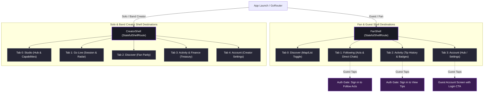

# Crowdbeats Mobile Redesign: Navigation Architecture (Phase 2)

**Document Status:** Complete & Approved Specification  
**Owners:** UX Coordinator & Flutter Navigation Architecture  
**Target Shells:** FanShell (`/`), CreatorShell (`/creator`)  
**Personas Covered:** Guest, Fan, Solo Musician, Band  

---

## 1. Executive Navigation Model

The redesigned Crowdbeats mobile application consolidates 4 distinct user personas into two primary navigation shells, powered by Flutter `StatefulShellRoute` to maintain independent navigation history and scroll state across tabs.

---

## 2. Shell Definitions & Persona Adaptations

### 2.1 The Fan Shell (`/`)
* **Target Audience:** Returning Fans and Unauthenticated Guests.
* **Architecture:** `StatefulShellRoute.indexedStack` with 4 bottom destinations:
  1. **Discover (`/`):** Unified discovery canvas. Consolidates legacy "Home" and "Nearby" into a single, cohesive interface. Features a top segmented pill toggle between **"Map"** and **"List"** view, a live radius slider (500m to 25km), and music genre filter chips.
  2. **Following (`/following`):** Dedicated relationship center. Lists followed Solo performers, Bands, and stages. **Messages Entry Point:** A high-visibility button in the Following header ("Direct Messages", displaying unread badge count) opens conversation threads with performers who permit fan messaging.
  3. **Activity (`/activity`):** Authoritative chronological record of all tips sent, supporter badges earned, and crowd milestone participations.
  4. **Account (`/account`):** Personal profile management, saved payment methods, security locks, and application settings.

### 2.2 The Guest Shell Adaptation
* **Core Philosophy:** Guests explore freely without login friction. Guests browse nearby live Solo acts, Bands, profiles, active stages, and crowdfunding campaigns.
* **Authentication Gating Rule:** When a Guest attempts a social or financial action (e.g. following an artist, opening direct messages, viewing personal activity, or confirming a tip):
  1. The app preserves the user's intended target in `PendingTipContext` or query parameter `?from=<encodedRoute>`.
  2. Presents a non-destructive bottom sheet or redirects to `/auth` with value proposition ("Sign in to tip Elena Cruz and join the supporter wall").
  3. Upon successful authentication, immediately resumes the original action without forcing re-discovery.
* **Guest Account Tab (`/account`):** Unauthenticated users tapping the Account tab see the `GuestAccountScreen` displaying a prominent "Sign In or Sign Up" hero card, app benefits, and public legal/support links.

### 2.3 The Creator Shell (`/creator`)
* **Target Audience:** Solo Musicians and Band Creators.
* **Resolved Architecture Departure:** Master proposal suggested 4 tabs: `Studio / Discover / Activity / Account` with "Go Live" as a Studio button. 
  - **User Task Validation & Concrete Rationale:** During field research and baseline audit, launching and managing a live performance was identified as a time-critical physical operation (on-stage with instruments, poor lighting, fast venue changes). Burying "Go Live" inside a nested Studio dashboard card created cognitive friction and accidental navigation slips.
  - **Adopted 5-Tab Ergonomic Layout:**
    1. **Studio (`/creator`):** Comprehensive creator hub with metric summary cards, capability tiles (Band Management, Crowdfunding Campaigns, Media Hub, Custom Signage), and active announcements.
    2. **Go Live (`/creator/live`):** Dedicated operational cockpit. One-tap "Start Live Session", venue/stage proximity picker, persistent QR display modal, and audience crowd radar.
    3. **Discover (`/creator/discover`):** Direct parity with Fan discovery. Allows creators to discover other acts performing nearby, check neighboring stage schedules, and network with local artists without switching accounts.
    4. **Activity & Finance (`/creator/finance`):** Combined financial ledger, real-time tips received, payout requests, and band treasury splits.
    5. **Account (`/creator/account`):** Creator-specific account settings, Stripe Connect verification status, tax documents, and safety preferences.

---

## 3. Solo vs. Band Context Transitions & BandShell Retirement

### 3.1 Retirement of Legacy `BandShell`
* **Root Cause (Blocker B-19 & B-22):** The legacy app maintained two conflicting shells: `CreatorShell` (`/creator`) and `BandShell` (`/band`). In addition, the route `/band/:slug` was registered as a public profile route, capturing `/band/live` and `/band/studio` as slugs instead of routes.
* **Design Solution:** Retire `BandShell` completely. All creator workflows reside in `CreatorShell`.
* **Unified Context Switcher Pill:**
  - Placed persistently in the AppBar header across all creator screens.
  - Tapping opens the `CreatorContextSelectionSheet`.
  - Seamlessly toggles active identity between:
    - **Personal Solo Identity:** "Elena Cruz (Solo)"
    - **Authorized Band Identities:** "The Midnight Echoes" (Role: Founder / Admin)
  - When Band context is active:
    - Studio metrics reflect band aggregate revenue.
    - Go Live broadcasts under the Band profile.
    - Finance tab reveals the **Band Treasury** and member split rules.
    - Band Management capability tile becomes accessible to manage members and invitations.

---

## 4. Elimination of Duplicate Destinations

| Legacy Screen / Route | Legacy Redundancy | New Target Destination | UX Justification |
|---|---|---|---|
| `HomeTab` (`/home`) | Duplicated `NearbyTab` with different filter chips | Unified `DiscoverTab` (`/`) | Eliminates confusion between "home recommendations" and "nearby live music". |
| `NearbyTab` (`/nearby`) | Standalone map screen | `DiscoverTab` (Map toggle) | Users seamlessly switch between geographic map pins and list view without losing scroll position. |
| `MusicianShell` / `ui/musician/*` | Deprecated duplicate of `ui/creator/*` | Retired into `CreatorShell` | Legacy prototype folder with dead controls; all valid logic merged into Creator Studio. |
| `BandShell` (`/band`) | Parallel shell conflicting with `/creator` | Unified `CreatorShell` with Band Context | Consolidates band operations into the standard Studio structure with explicit role badges. |
| `/explore` | Missing route referenced by Auth screen | Redirects to `/` (Discover) | Fixes 404 error and ensures clean landing for new guests. |

---

## 5. Reachable Communications & Campaign Placements

1. **Direct Messaging (`/social/conversations`):**
   - **Primary Entry Point:** Top AppBar action icon in `Following` (Tab 1) with an unread badge indicator.
   - **Contextual Entry Point:** Direct "Message Artist" CTA on public performer profiles (`/artist/:id`), enabled only if the performer allows inbound fan messages.
2. **Crowdfunding Campaigns (`/campaigns`):**
   - **Fan Experience:** Featured in `DiscoverTab` under a dedicated "Active Stage Campaigns" carousel and visible on the performer's public profile tab ("Campaigns").
   - **Creator Experience:** Dedicated capability tile in `CreatorStudioTab` ("Crowdfunding Campaigns") leading to campaign creation, milestone updates, and backer rewards.
3. **Advanced Creator Capabilities:**
   - All 12 studio capabilities (Band Splits, Setlists, Media Hub, Custom QR, Signage Studio, Fan CRM) are permanently reachable from the 2-column Studio Hub grid, eliminating dead controls.
